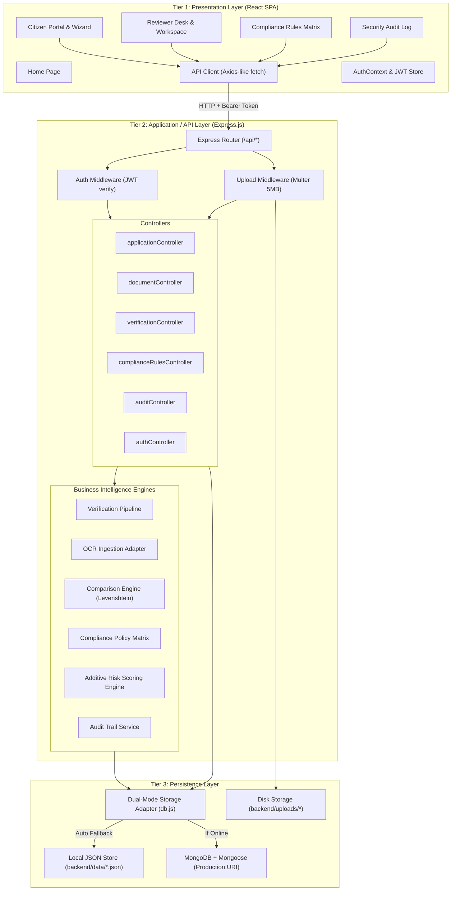
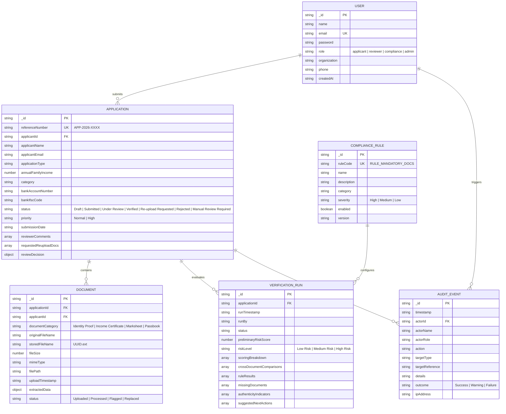
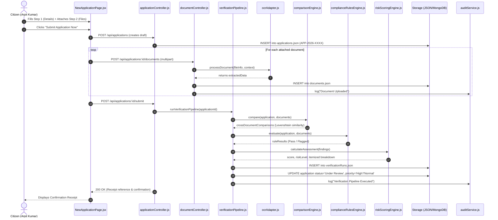
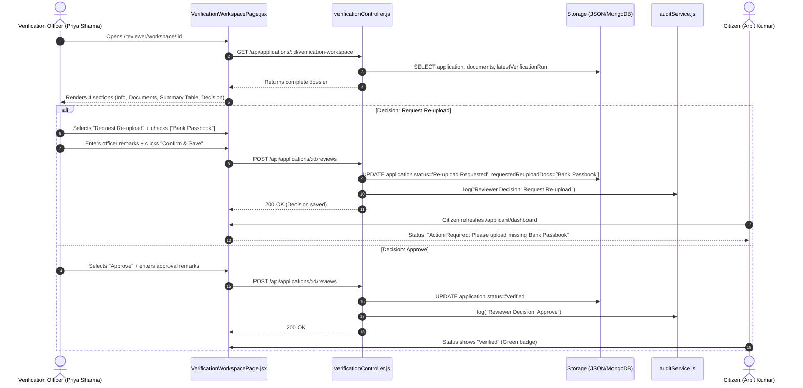

# Application Architecture and Data Flow

This document details the complete end-to-end architecture, entity relationships, database schemas, and data flow pipelines of the Suvidha portal.

---

## 1. System Architecture Overview

The system follows a clean **Three-Tier Service-Oriented Architecture (SOA)** with strict separation of concerns:

---

## 2. Database Entities and Data Models

The persistence layer supports both **MongoDB with Mongoose** and a **persistent JSON store** in `backend/data/`. All six collections share identical schemas:

### Entity Relationship Diagram (ERD)

---

## 3. End-to-End Data Flow Pipelines

### Pipeline A: Citizen Application Submission & Automated Screening

---

### Pipeline B: Reviewer Adjudication & Decision Recording

---

## 4. Data Lifecycle: CRUD Operations Matrix

| Entity | Created At | Read At | Updated At | Deleted At |
| :--- | :--- | :--- | :--- | :--- |
| **User** | Seed script (`seedData.js`) or `POST /api/auth/register`. | `POST /api/auth/login`, `GET /api/auth/me`. | Profile updates. | Admin user management (protected). |
| **Application** | `POST /api/applications` (`createApplication`). | `GET /api/applications`, `GET /api/applications/:id`, `GET /.../verification-workspace`. | `PATCH /api/applications/:id` (draft edits), `submitApplication`, `recordReviewDecision` (status, comments, decision). | Never hard-deleted in production; marked inactive for statutory audit. |
| **Document** | `POST /api/applications/:id/documents` (`uploadDocument`). | `GET /api/applications/:id/documents`, `GET /api/documents/:id/file`. | Marked `status: 'Replaced'` when applicant uploads a newer certificate. | `DELETE /api/documents/:id` (removes disk file and unlinks from store). |
| **Verification Run** | `runVerificationPipeline()` invoked automatically on submission, upload, or manual trigger. | `getVerificationDetails()`, `getApplicationById()`. | Append-only; new run created each time to preserve historical evaluation lineage. | Never deleted; immutable verification record. |
| **Compliance Rule** | Seed script (`seedData.js`). | `GET /api/compliance-rules`, `ComplianceRulesEngine.evaluate()`. | `PATCH /api/compliance-rules/:id/toggle` (enabled true/false), `PATCH /api/compliance-rules/:id`. | Protected; system rules cannot be removed. |
| **Audit Event** | `AuditService.log()` on every system event. | `GET /api/audit-events` (`getAuditEvents`). | **Immutable.** Never updated. | **Append-only.** Never deleted. |
