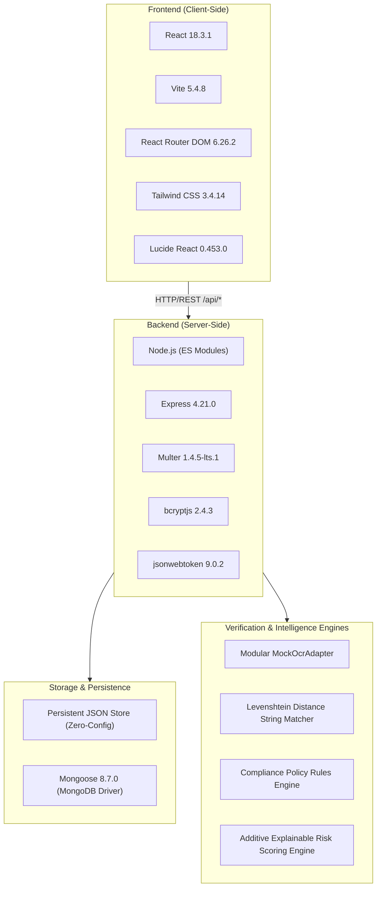

# Complete Technology Stack Reference

This document identifies every technology, library, tool, and framework actually present and verifiable in the Suvidha codebase. No unverified technologies or hypothetical libraries are listed.

---

## 1. Summary of Verified Technologies

---

## 2. Frontend Technologies

### 1. React (v18.3.1)
- **File Evidence:** `frontend/package.json` (line 14), `frontend/src/main.jsx`, `frontend/src/App.jsx`.
- **Why It Is Used:** Serves as the core reactive UI framework for managing component states, declarative UI rendering, and user interactions across all dashboard pages.
- **Key Features Used:** `useState`, `useEffect`, `useContext`, `createContext`, `useParams`, `useNavigate`, `useLocation`.

### 2. Vite (v5.4.8)
- **File Evidence:** `frontend/package.json` (line 26), `frontend/vite.config.js`.
- **Why It Is Used:** Next-generation frontend build tool and local development server. Provides instant Hot Module Replacement (HMR) and fast Rollup-based production bundling.
- **Port:** Runs locally on port `3000` (`http://localhost:3000`). Configured with reverse-proxy `/api` routing to `http://localhost:5000` in `vite.config.js`.

### 3. React Router DOM (v6.26.2)
- **File Evidence:** `frontend/package.json` (line 16), `frontend/src/App.jsx`.
- **Why It Is Used:** Handles client-side declarative routing, URL parameter extraction (`useParams`), navigation redirects (`useNavigate`, `Navigate`), and role-based route protection (`ProtectedRoute`).
- **Configured Routes:** 12 client-side routes mapped in `App.jsx`.

### 4. Tailwind CSS (v3.4.14) & PostCSS / Autoprefixer
- **File Evidence:** `frontend/package.json` (lines 23–25), `frontend/tailwind.config.js`, `frontend/src/index.css`.
- **Why It Is Used:** Utility-first CSS framework used to build the strict Government Saffron + Neutral visual design system without arbitrary CSS stylesheets.
- **Custom Design Tokens Configured in `tailwind.config.js`:**
  - Primary saffron: `#E98222` (`saffron`)
  - Dark saffron hover: `#C66914` (`saffron-hover`)
  - Light saffron background: `#FFF2E4` (`saffron-light`)
  - Navy text: `#263B52` (`navy`)
  - Neutral page background: `#F6F7F9` (`surface-bg`)
  - Card background: `#FFFFFF` (`surface-card`)
  - Border color: `#DDE3E8` (`surface-border`)
  - Semantic status colors: Success (`#23734D`), Warning (`#A86412`), Error (`#B42318`), Info (`#245A82`).

### 5. Lucide React (v0.453.0)
- **File Evidence:** `frontend/package.json` (line 13).
- **Why It Is Used:** Comprehensive, accessible SVG icon library providing uniform government-style iconography (`ShieldCheck`, `FileText`, `CheckCircle2`, `AlertCircle`, `RefreshCw`, `Search`, `UploadCloud`, etc.) across all pages. No emojis are used.

### 6. clsx (v2.1.1) & tailwind-merge (v2.5.4)
- **File Evidence:** `frontend/package.json` (lines 12, 17).
- **Why It Is Used:** Utility helpers for conditionally combining CSS class names safely without class duplication.

---

## 3. Backend Technologies

### 1. Node.js (ES Modules)
- **File Evidence:** `backend/package.json` (`"type": "module"`), `backend/src/server.js`.
- **Why It Is Used:** Server-side JavaScript runtime environment executing backend business logic using modern ECMAScript standard import/export syntax.

### 2. Express.js (v4.21.0)
- **File Evidence:** `backend/package.json` (line 16), `backend/src/server.js`, `backend/src/routes/api.js`.
- **Why It Is Used:** Minimalist web application framework for structuring the REST API, mounting route controllers, parsing incoming JSON and URL-encoded bodies, and handling application errors.
- **Port:** Configured to run on port `5000` (`http://localhost:5000`).

### 3. Multer (v1.4.5-lts.1)
- **File Evidence:** `backend/package.json` (line 19), `backend/src/middleware/upload.js`.
- **Why It Is Used:** Multipart form-data middleware for processing file uploads. Configured with:
  - Disk storage writing to `backend/uploads/`.
  - Filename randomization with UUIDv4 (`${uuidv4()}${ext}`).
  - File extension & MIME type whitelist (`application/pdf`, `image/jpeg`, `image/png`).
  - Size limitation enforced at `5MB` (`limits: { fileSize: 5 * 1024 * 1024 }`).

### 4. jsonwebtoken (v9.0.2)
- **File Evidence:** `backend/package.json` (line 17), `backend/src/middleware/auth.js`.
- **Why It Is Used:** Generates cryptographically signed JWT Bearer tokens upon user authentication (24-hour expiry) containing the user's ID, email, name, and role. Verifies tokens on protected endpoints.

### 5. bcryptjs (v2.4.3)
- **File Evidence:** `backend/package.json` (line 13), `backend/src/controllers/authController.js`, `backend/src/seeds/seedData.js`.
- **Why It Is Used:** Performs secure one-way salted hashing of user passwords (salt factor: 10) during account registration and database seeding. Compares hashes during login without storing plain text.

### 6. uuid (v10.0.0)
- **File Evidence:** `backend/package.json` (line 20), `backend/src/storage/jsonStore.js`, `backend/src/middleware/upload.js`.
- **Why It Is Used:** Generates RFC4122 UUIDv4 unique identifiers for new database entities (applications, documents, verification runs) and uploaded files.

### 7. dotenv (v16.4.5)
- **File Evidence:** `backend/package.json` (line 15), `backend/src/config/index.js`.
- **Why It Is Used:** Loads configuration parameters from `backend/.env` into `process.env`.

### 8. cors (v2.8.5)
- **File Evidence:** `backend/package.json` (line 14), `backend/src/server.js`.
- **Why It Is Used:** Configures Cross-Origin Resource Sharing headers to allow API communication between the frontend Vite server (`localhost:3000`) and the Express backend (`localhost:5000`).

---

## 4. Storage & Persistence Technologies

### Dual-Mode Persistence Architecture
The project employs an intelligent dual-mode storage adapter in `backend/src/storage/db.js`:

#### Mode A: Persistent JSON Store (`backend/src/storage/jsonStore.js`)
- **Default Mode for Zero-Setup Evaluation.**
- Stores data in persistent JSON files under `backend/data/`:
  - `applications.json`
  - `documents.json`
  - `verificationRuns.json`
  - `complianceRules.json`
  - `auditEvents.json`
  - `users.json`
- Implements Mongoose-compatible async querying methods: `find()`, `findOne()`, `findById()`, `create()`, `findByIdAndUpdate()`, `deleteMany()`, `countDocuments()`.
- Data persists across server restarts and hot reloads.

#### Mode B: MongoDB with Mongoose (v8.7.0)
- **File Evidence:** `backend/package.json` (line 18), `backend/src/storage/db.js`.
- **Why It Is Used:** Production-grade object-document mapping (ODM). When a MongoDB instance is detected at `mongodb://localhost:27017/suvidha`, the server automatically connects and compiles Mongoose schemas. If MongoDB is offline, it cleanly logs a notice and switches to the JSON store without crashing.

---

## 5. Testing and Tooling

### 1. Node.js Built-In Test Runner (`node --test`)
- **File Evidence:** `backend/package.json` (`"test": "node --test tests/*.test.js"`), `backend/tests/api.test.js`, `backend/tests/engines.test.js`.
- **Why It Is Used:** Lightweight, zero-dependency test runner native to Node.js 18+. Executes 8 comprehensive test cases covering health checks, authentication, application scoping, reviewer workspace retrieval, Levenshtein string matching, and risk score calculation.

### 2. PowerShell Startup Script (`start-portal.ps1`)
- **File Evidence:** `start-portal.ps1`.
- **Why It Is Used:** Single-command bootstrap script that launches the backend server on port 5000 and the Vite frontend on port 3000 concurrently in background sessions.
